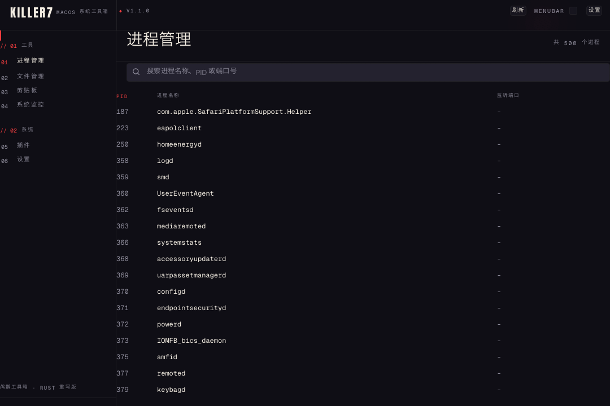
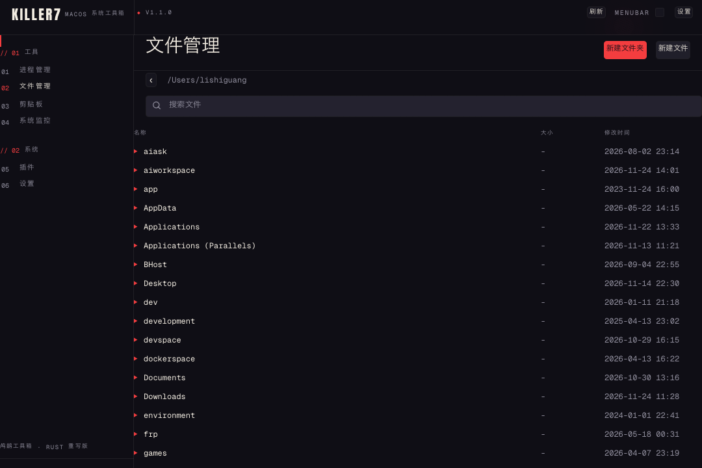
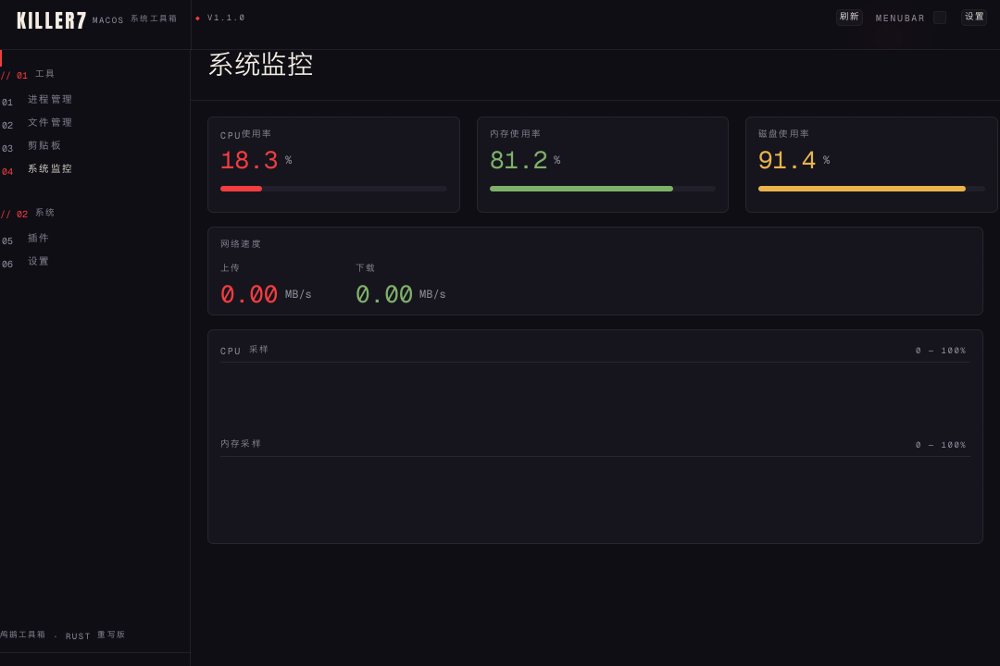
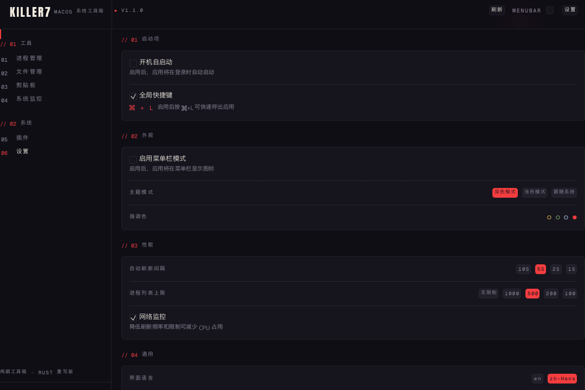

# killer7

> 鸬鹚工具箱 LuciBox 的 **Rust 重写版** · 一个 macOS 系统工具箱
>
> 进程管理 · 文件管理 · 剪贴板管理 · 系统监控 · 菜单栏模式 · 全局快捷键 · 插件架构

`killer7` 是 [LuciBox](https://github.com/hagenmagpie/LuciBox)（SwiftUI + AppKit）用
**Rust + egui** 重新实现的功能对等版本。业务逻辑、数据来源与交互语义保持一致，
界面语言则换成了更克制的「ink / paper」暗色系。

界面风格参考 [cindy.cn](https://cindy.cn)：近黑底色、奶油色文字、单一强调色，
发丝级描边、等宽全大写小标题，以及宽字距的展示字体。

---

## 界面预览

### 进程管理



### 文件管理



### 系统监控



### 设置



---

## 功能

| 模块 | 能力 |
| --- | --- |
| **进程管理** | 列出全部系统进程（PID / 名称 / 监听端口）、实时搜索、按 PID/名称/端口排序、右键查看与复制路径、结束进程（二次确认） |
| **文件管理** | 目录浏览、新建文件与文件夹、重命名、删除到废纸篓、Finder 定位、复制路径、搜索、目录变更自动刷新 |
| **剪贴板** | 查看当前剪贴板、最近 100 条历史、搜索、一键复制、单条删除、清空、本地持久化 |
| **系统监控** | CPU / 内存 / 磁盘使用率，上传下载速度，CPU 与内存采样曲线 |
| **菜单栏模式** | 菜单栏常驻图标，左键唤起主窗口，右键菜单显示实时指标 |
| **全局快捷键** | `⌘ + L` 快速激活应用 |
| **主题** | 跟随系统 / 浅色 / 深色，四种强调色，实时切换 |
| **国际化** | 简体中文 / English，文案表直接复用原版 `.strings` 文件 |
| **插件** | 扫描插件目录、解析 `manifest.json`、注册标签页与命令 |

---

## 快速开始

```bash
# 需要 Rust 1.88 及以上
cargo build --release

# 运行
./target/release/killer7
```

### 打包成 .app

裸二进制在 Dock 与菜单栏行为上与 `.app` 包不同，建议打包后再使用：

```bash
cargo build --release

APP="target/release/killer7.app"
mkdir -p "$APP/Contents/MacOS" "$APP/Contents/Resources"
cp target/release/killer7 "$APP/Contents/MacOS/killer7"

cat > "$APP/Contents/Info.plist" <<'PLIST'
<?xml version="1.0" encoding="UTF-8"?>
<!DOCTYPE plist PUBLIC "-//Apple//DTD PLIST 1.0//EN" "http://www.apple.com/DTDs/PropertyList-1.0.dtd">
<plist version="1.0">
<dict>
    <key>CFBundleExecutable</key><string>killer7</string>
    <key>CFBundleIdentifier</key><string>org.igigi.killer7</string>
    <key>CFBundleName</key><string>killer7</string>
    <key>CFBundlePackageType</key><string>APPL</string>
    <key>CFBundleShortVersionString</key><string>1.1.0</string>
    <key>CFBundleVersion</key><string>1</string>
    <key>LSMinimumSystemVersion</key><string>13.0</string>
    <key>NSHighResolutionCapable</key><true/>
    <key>LSUIElement</key><true/>
</dict>
</plist>
PLIST

open "$APP"
```

`LSUIElement` 为 `true` 时应用不占用 Dock 位置，只在菜单栏常驻。

---

## 与 Swift 原版的对应关系

| Swift 原版 | Rust 重写 |
| --- | --- |
| `LuciBoxApp.swift` | `src/main.rs` + `src/app.rs` |
| `ContentView.swift` | `src/views/processes.rs` |
| `ProcessManager.swift` | `src/process.rs` |
| `FileManagerView.swift` | `src/files.rs` |
| `FileManagerContentView.swift` | `src/views/files.rs` |
| `ClipboardManager.swift` | `src/clipboard.rs` |
| `ClipboardContentView.swift` | `src/views/clipboard.rs` |
| `SystemMonitor.swift` | `src/monitor.rs` |
| `SystemMonitorView.swift` | `src/views/monitor.rs` |
| `ThemeManager.swift` | `src/theme.rs` |
| `MenuBarManager.swift` | `src/menubar.rs` |
| `GlobalShortcutManager.swift` | `src/shortcut.rs` |
| `AutoLaunchManager.swift` | `src/autolaunch.rs` |
| `PluginSystem.swift` | `src/plugin.rs` + `src/views/plugins.rs` |
| `Info.plist` / `@AppStorage` | `src/settings.rs`（`settings.json`） |
| `Localizable.strings` | `locales/*/Localizable.strings`（原样复用） |

### 实现差异

| 方面 | Swift 版 | Rust 版 |
| --- | --- | --- |
| GUI | SwiftUI / AppKit | egui / eframe |
| 进程列表 | `/bin/ps -eo pid,comm` | 同样调用 `ps`，解析在 Rust 侧完成 |
| 监听端口 | `lsof` + `awk` 预处理 | `lsof` + Rust 侧解析（可显示真实绑定地址） |
| 系统指标 | `host_processor_info` / `host_statistics64` / `getifaddrs` | `sysinfo` crate |
| 剪贴板 | `NSPasteboard.changeCount` 轮询 | `arboard` crate 每秒读取比对 |
| 目录监听 | `DispatchSource` | `notify` crate |
| 全局快捷键 | `NSEvent.addGlobalMonitor` | `global-hotkey` crate（系统级注册，无需辅助功能权限） |
| 开机自启 | `SMAppService`（macOS 13+） | LaunchAgent plist + `launchctl` |
| 设置存储 | `UserDefaults` | `~/Library/Application Support/killer7/settings.json` |

---

## 项目结构

```
killer7/
├── Cargo.toml
├── build.rs                     # 字体可选加载
├── assets/fonts/                # Anton（展示体）+ Geist Mono（等宽），均为 SIL OFL
├── locales/                     # 简体中文 / English 文案表
├── docs/PLUGIN_ARCHITECTURE.md  # 插件系统设计说明
├── docs/screenshots/            # 界面预览图
└── src/
    ├── main.rs                  # 入口、字体安装
    ├── app.rs                   # 窗口布局、事件分发
    ├── ui_kit.rs                # 设计基元（kicker / 卡片 / 曲线 / 导航项）
    ├── theme.rs                 # ink / paper 配色与强调色
    ├── i18n.rs                  # .strings 解析与占位符填充
    ├── settings.rs              # 设置持久化
    ├── events.rs                # 后台线程 → UI 的事件通道
    ├── process.rs               # 进程管理
    ├── files.rs                 # 文件管理
    ├── clipboard.rs             # 剪贴板管理
    ├── monitor.rs               # 系统监控
    ├── plugin.rs                # 插件清单与注册
    ├── menubar.rs               # 菜单栏托盘
    ├── shortcut.rs              # 全局快捷键
    ├── autolaunch.rs            # 开机自启
    ├── icon.rs                  # 程序化生成菜单栏图标
    ├── platform.rs              # macOS 平台调用
    └── views/                   # 各功能页
        ├── processes.rs  files.rs  clipboard.rs
        ├── monitor.rs    plugins.rs  settings.rs
```

---

## 设计语言

视觉参考 [cindy.cn](https://cindy.cn)，抽取出以下设计令牌：

| 令牌 | 暗色（ink） | 浅色（paper） |
| --- | --- | --- |
| 背景 | `#0F0E15` | `#FAF6EE` |
| 面板 | `#16151E` | `#F3EDE2` |
| 高层面板 | `#201F2A` | `#EAE2D2` |
| 正文 | `#F3EDE2` | `#14131B` |
| 次要文字 | `#918F9E` | `#5D5B66` |
| 强调色 | `#F43D3F` | `#CF2B30` |

- **字体**：展示层用 `Anton`（宽字距全大写），数据与标签用 `Geist Mono`。
  字距通过在字符间插入细空格（U+2009）实现，脱离字体也能保持排版。
- **描边**：一律 1px 低透明度发丝线，不用投影。
- **圆角**：4 – 8px，接近直角。
- **分隔符**：`◆`、`// 01`、`·` 等符号，呼应参考站的工业排版。

---

## 开发

```bash
cargo fmt          # 格式化
cargo clippy       # 静态检查
cargo test         # 单元测试
cargo run          # 开发模式运行
```

字体是可选增强：若 `assets/fonts/` 下的字体文件缺失，`build.rs` 会关闭对应
cfg，程序自动回退到系统字体，不影响编译与运行。

用环境变量 `KILLER7_START_TAB` 可以指定启动时打开的标签页，取值为
`process` / `files` / `clipboard` / `monitor` / `plugins` / `settings`：

```bash
KILLER7_START_TAB=monitor cargo run
```

---

## 许可证

本项目采用 [MIT](LICENSE) 许可证。

第三方资源：

- `assets/fonts/Anton-Regular.ttf` —— Anton，SIL Open Font License 1.1，
  见 `assets/fonts/LICENSE-Anton.txt`
- `assets/fonts/GeistMono-Variable.ttf` —— Geist Mono，SIL Open Font License 1.1，
  见 `assets/fonts/LICENSE-GeistMono.txt`

原版 LuciBox 亦为 MIT 许可证，版权归 Igigi 所有。
