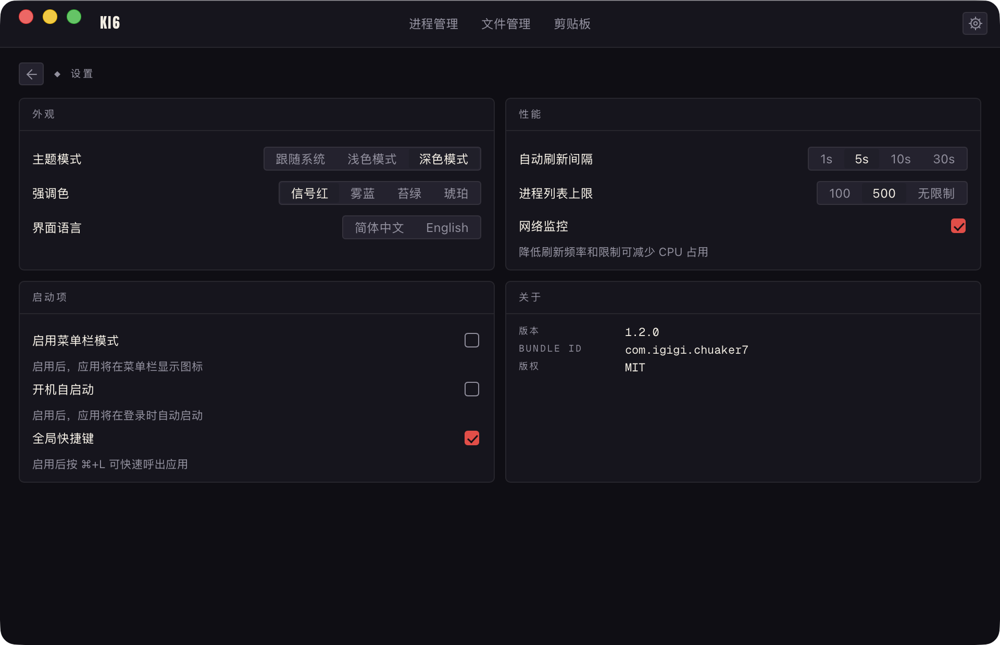

# Ki6

> 鸬鹚工具箱 —— 进程管理 · 文件管理 · 剪贴板管理 · 系统监控 · 全局快捷键

Ki6 是一个常驻托盘的桌面工具箱：把每天都要看的**进程、文件、剪贴板、系统指标**
收进同一个窗口，做成一张可以一直开着的列表。

界面是克制的 ink / paper 暗色语言（近黑底、奶油色文字、单一强调色），
交互模型只有一条，跨页一致：

> **单击 = 选中变色 · 双击 = 主操作 · 右键 = 全部功能**

---

## 下载

### macOS（Apple Silicon）

| 文件 | 说明 |
| --- | --- |
| [`Ki6_1.2.0_aarch64.dmg`](release/Ki6_1.2.0_aarch64.dmg) | 磁盘映像，双击后拖进「应用程序」 |
| [`Ki6.zip`](release/Ki6.zip) | `Ki6.app` 的压缩包，解压即用 |

最低系统版本 macOS 12.0。首次运行未签名（ad-hoc 签名），Gatekeeper 会拦一下 ——
在「系统设置 → 隐私与安全性」里点「仍要打开」，或右键点「打开」。

### Windows（x64）

| 文件 | 说明 |
| --- | --- |
| [`Ki6_1.2.0_x64-setup.exe`](release/Ki6_1.2.0_x64-setup.exe) | NSIS 安装包，安装界面简体中文 / English |

安装包同样未做代码签名，SmartScreen 会提示未知发布者 —— 点「更多信息 → 仍要运行」。

两个平台的文件都挂在 [Releases 页面](https://github.com/chuaker7/Ki6/releases/tag/v1.2.0) 上，
仓库里的 `release/` 目录也各存了一份。

---

## 界面预览

| 进程管理 | 文件管理 | 剪贴板 |
| --- | --- | --- |
|  |  |  |

| 设置 |
| --- |
|  |

> 截图取自**正在运行的 Ki6 应用本身**（真实渲染、真实进程、真实目录、真实剪贴板内容），
> 窗口尺寸 960×620。

### 布局

```
┌──────────────────────────────────────────────────────────────┐
│  KI6             进程 文件 剪贴板                      ⚙    │ ← 工具栏
├──────────────────────────────────────────────────────────────┤
│  PROCESSES                              [⌕ 搜索]  [按钮…]    │ ← 页头行
├──────────────────────────────────────────────────────────────┤
│                                                              │
│                        当前页内容                              │
│                                                              │
├──────────────────────────────────────────────────────────────┤
│  CPU 9.0%   CPU 负载 ▁▂▃▂▁▂    进程 500                      │ ← 底部汇总栏
│  内存 60.6%                    网络 ↑0.0 ↓0.0                 │
└──────────────────────────────────────────────────────────────┘
```

- **没有左侧栏**：工具栏里的标签条居中，点击切换视图
- **搜索贴着操作按钮**：页头行右侧，搜索框在左、操作按钮在右，同属「作用于当前页」的一组
- **设置不进标签条**：工具栏右上角一个齿轮按钮，低频入口不占主导航位置
- **排序靠表头箭头**：点列头切换升/降序，没有额外的排序开关
- **行内没有按钮**：复制、重命名、删除等动作都在原生右键菜单里
- **底部汇总栏**：系统级指标 + CPU 负载曲线 + 进程数与网络速率
- 配色与排版是 ink / paper 暗色语言 —— 借的是**布局**，不是皮肤

---

## 功能

| 模块 | 能力 |
| --- | --- |
| **进程管理** | 列出全部系统进程（PID / 名称 / 监听端口）、实时搜索、点列头排序、复制可执行路径、结束进程（二次确认） |
| **文件管理** | 目录浏览、新建文件与文件夹、重命名、删除到回收站、在文件管理器中定位、复制路径、搜索、点列头排序、目录变更自动刷新 |
| **剪贴板** | 查看当前剪贴板、最近 100 条历史、搜索、点列头排序、复制与单条删除、清空、本地持久化 |
| **应用菜单** | 一套完整的原生菜单（关于 / 设置 / 编辑 / 视图 / 窗口），⌘1–⌘3 切换页面，⌘, 打开设置 |
| **原生右键菜单** | 进程 / 文件 / 剪贴板列表行的动作全部收在右键菜单里（列表内没有按钮），菜单文案跟随应用语言 |
| **托盘** | 托盘常驻小鸟图标，左键唤起主窗口，右键菜单显示实时指标 |
| **托盘模式** | 可切换是否占用 Dock / 任务栏图标位置，只在托盘常驻（macOS 上称为「菜单栏模式」） |
| **全局快捷键** | 一键快速激活应用（macOS `⌘+L`，Windows `Ctrl+Alt+L`） |
| **开机自启** | 登录后自动拉起 |
| **单实例** | 开机自启与手动打开撞车时只保留一个进程，第二次启动会把已有实例的窗口唤出来 |
| **主题** | 跟随系统 / 浅色 / 深色，四种强调色，实时切换 |
| **国际化** | 简体中文 / English，应用菜单与界面文案全部跟随应用语言 |

### 行交互模型

三页共用一套模型，行为完全一致：

| 操作 | 进程 | 文件 | 剪贴板 |
| --- | --- | --- | --- |
| **单击** | 选中高亮 | 选中高亮 | 选中高亮 |
| **双击** | 结束进程（弹确认框） | 目录进入 / 文件用默认程序打开 | 复制到系统剪贴板 |
| **右键** | 复制路径 · 结束进程 | 打开/进入 · 在文件管理器中显示 · 复制路径 · 重命名 · 删除 | 复制 · 删除 |

右键时会把选中态先挪到目标行 —— 不会出现「高亮 A、菜单却操作 B」。

---

## 技术架构

### 分层

```
前端（React + TypeScript）
  │  Tauri 命令 / 事件
  ▼
commands/        Tauri 命令门面：只做 DTO 转换与状态读写
  │
  ▼
core/            纯业务逻辑：不依赖 tauri crate，全部可单测
  │
  ▼
system/          原生集成与线程调度：菜单、托盘、快捷键、自启、激活策略
```

一条铁律：**`core/` 不依赖 `tauri` crate**。业务规则因此可以脱离窗口与事件循环单测，
平台差异也不会渗进业务层。

### 状态模型

**Rust 侧是唯一权威状态源。** 前端不是数据的所有者，它通过 `useSyncExternalStore`
订阅 Rust 发出的事件来同步：

```
Rust AppState  ──emit──▶  前端 store  ──▶  组件
      ▲                                          │
      └──────────── invoke（命令）◀───────────────┘
```

后台采样（进程列表、剪贴板、系统指标）与文件监听各自跑在独立线程上，
把结果写回 `AppState` 再广播给前端；前端只负责展示与发起动作。

### 平台适配

跨平台差异集中在一个 `backend` 子模块里收口，业务层看到的接口完全一致：

| 能力 | macOS / Linux | Windows |
| --- | --- | --- |
| 进程列表 | `ps -eo pid=,comm=` | `sysinfo` |
| 监听端口 | `lsof -nP -iTCP -sTCP:LISTEN` | `netstat -ano -p TCP` |
| 结束进程 | `kill -9` | `taskkill /PID <pid> /F` |
| 开机自启 | LaunchAgent plist | 注册表 Run 键 |
| 托盘模式 | 切换激活策略 + 隐藏窗口 | 隐藏窗口 |
| 全局快捷键 | `⌘+L` | `Ctrl+Alt+L` |
| 文件定位 | 在文件管理器中选中 | 在资源管理器中选中 |

依赖也按目标平台挂载：只服务于单一平台的库放在
`[target.'cfg(target_os = "macos")'.dependencies]` 下，不进通用依赖表。

### 目录结构

```
Ki6/
├── frontend/                  # React + TypeScript 前端（Vite）
│   ├── src/
│   │   ├── main.tsx           # 入口
│   │   ├── App.tsx            # 根组件（挂载 AppShell）
│   │   ├── lib/               # Tauri 桥接层、store、类型
│   │   ├── app/               # 应用外壳：AppShell / Toolbar / BottomBar / Toast / 导航
│   │   ├── components/        # 通用组件（含 VirtualList / DataTable / Sparkline）
│   │   ├── pages/             # 三个功能页 + 设置
│   │   ├── styles/            # 设计令牌与基础样式
│   │   └── test/setup.ts      # vitest 环境
│   └── index.html
├── src-tauri/
│   ├── src/
│   │   ├── lib.rs             # Tauri Builder、插件注册、命令注册
│   │   ├── main.rs            # 二进制入口
│   │   ├── state.rs           # AppState（唯一权威状态源）
│   │   ├── events.rs          # 前后端事件常量
│   │   ├── core/              # 纯业务逻辑（不依赖 tauri crate）
│   │   │   ├── process.rs  files.rs  clipboard.rs  monitor.rs
│   │   │   ├── settings.rs  i18n.rs  theme.rs
│   │   │   └── platform.rs  icon.rs
│   │   ├── commands/          # Tauri command 门面 + DTO
│   │   └── system/            # 原生集成
│   │       ├── menu.rs        # 应用菜单
│   │       ├── tray.rs        # 托盘图标与托盘菜单
│   │       ├── shortcut.rs    # 全局快捷键
│   │       ├── activation.rs  # 托盘模式
│   │       ├── autolaunch.rs  # 开机自启
│   │       ├── single_instance.rs # 单实例仲裁与唤起请求
│   │       └── tasks.rs       # 后台采样与监听循环
│   ├── Cargo.toml
│   ├── tauri.conf.json
│   ├── tauri.windows.conf.json
│   └── icons/
├── locales/                   # 简体中文 / English 文案表
├── assets/fonts/              # Anton（展示体）+ Geist Mono（等宽），均为 SIL OFL
├── docs/
├── scripts/
└── .github/workflows/         # CI：Windows 构建
```

---

## 设计语言

视觉参考 [cindy.cn](https://cindy.cn)，抽取出以下设计令牌：

| 令牌 | 暗色（ink） | 浅色（paper） |
| --- | --- | --- |
| 背景 | `#0F0E15` | `#FAF6EE` |
| 面板 | `#16151E` | `#F3EDE2` |
| 高层面板 | `#201F2A` | `#EAE2D2` |
| 正文 | `#F3EDE2` | `#14131B` |
| 次要文字 | `#918F9E` | `#5D5B66` |
| 强调色 | `#F43D3F` | `#CF2B30` |

- **字体**：展示层用 `Anton`（宽字距全大写），数据与标签用 `Geist Mono`。
  字距通过在字符间插入细空格（U+2009）实现，脱离字体也能保持排版。
- **描边**：一律 1px 低透明度发丝线，不用投影。
- **圆角**：4 – 8px，接近直角。
- **分隔符**：`◆`、`// 01`、`·` 等符号，呼应参考站的工业排版。

---

## 开发

```bash
npm install
npm run build       # tsc --noEmit && vite build
cargo build --release -p chuaker7
```

> **构建顺序**：Tauri 的 `generate_context!` 在编译期会校验 `frontend/dist` 存在，
> 所以任何 Rust 构建之前必须先跑一次 `npm run build`。

日常检查：

```bash
npm run typecheck   # tsc --noEmit
npm run test        # vitest
cargo fmt           # 格式化
cargo clippy -p chuaker7 --all-targets
cargo test -p chuaker7
```

跨平台编译检查（不需要 Windows 机器，只查不链接）：

```bash
rustup target add x86_64-pc-windows-msvc
cargo check --target x86_64-pc-windows-msvc --all-targets
```

打包：

```bash
npm run tauri build                      # 当前平台
npm run tauri build -- --bundles nsis     # Windows 安装包（需在 Windows 上跑）
```

Windows 安装包由 CI 的 `windows-latest` 任务产出（`.github/workflows/release-windows.yml`），
产物作为 workflow artifact 上传。

### 性能

列表页用自研虚拟列表渲染（行高 26px，overscan 8），500 行数据时 DOM 行节点
保持在 60 以内，滚动稳定 120fps。实测基线与测量方法见
[docs/PERFORMANCE.md](docs/PERFORMANCE.md)。

### 目录约定

`src-tauri/` 是 cargo 工作区的成员，**产物在仓库根的 `target/`**，
不是 `src-tauri/target/`。

---

## 许可证

本项目采用 [MIT](LICENSE) 许可证。

第三方资源：

- `assets/fonts/Anton-Regular.ttf` —— Anton，SIL Open Font License 1.1，
  见 `assets/fonts/LICENSE-Anton.txt`
- `assets/fonts/GeistMono-Variable.ttf` —— Geist Mono，SIL Open Font License 1.1，
  见 `assets/fonts/LICENSE-GeistMono.txt`
