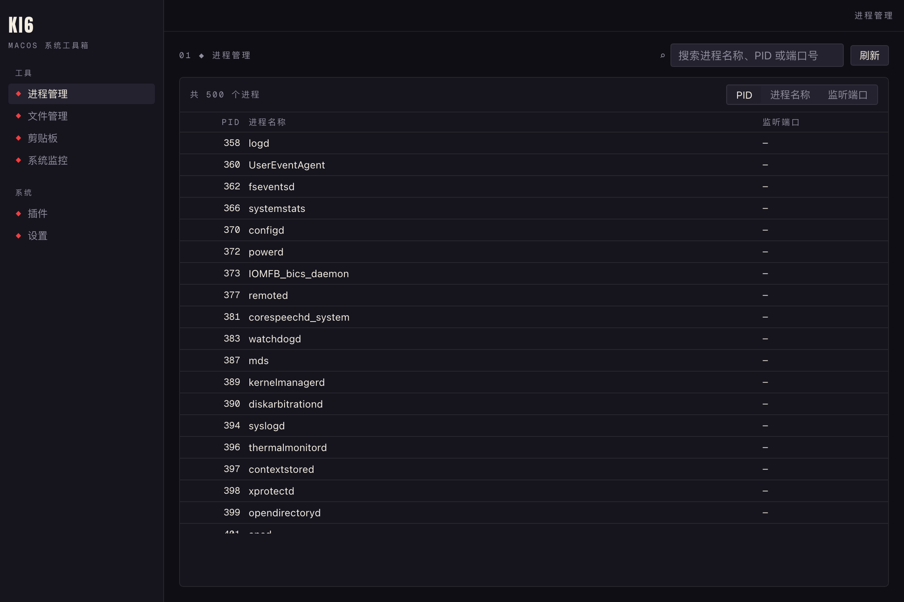
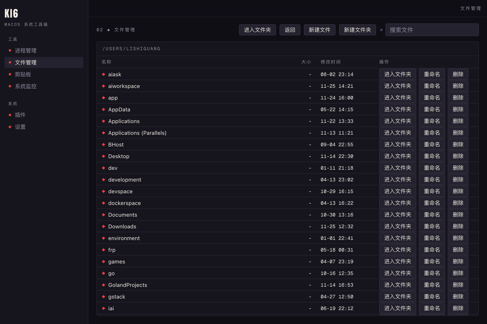
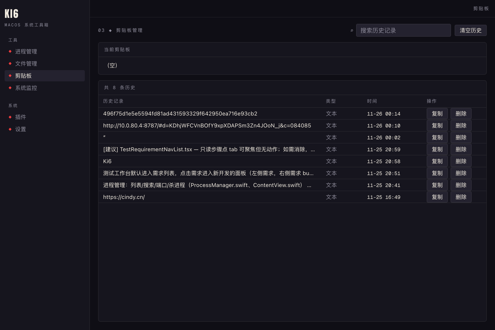
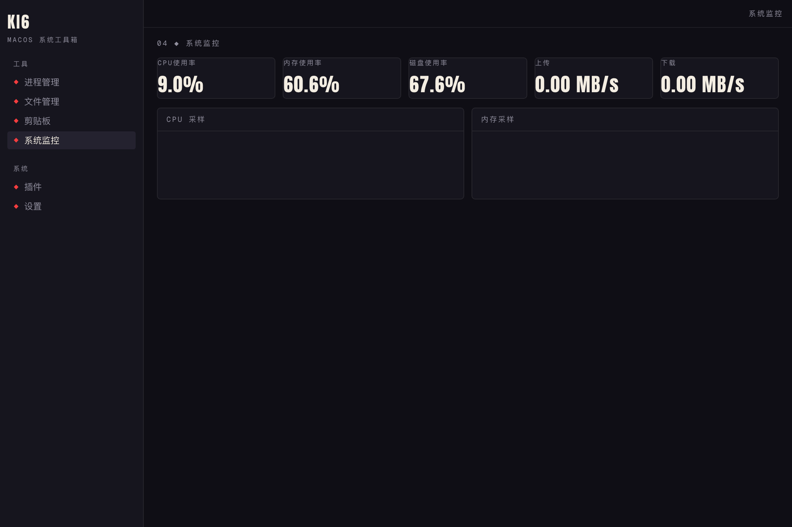
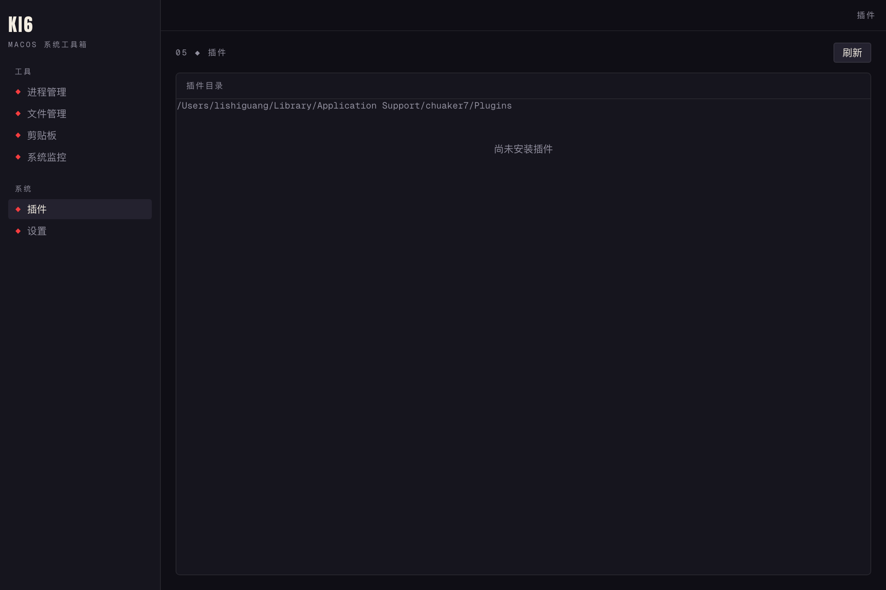

# Ki6

> 鸬鹚工具箱 —— macOS 系统工具箱 · **Tauri v2 + React + TypeScript 重写版**
>
> 进程管理 · 文件管理 · 剪贴板管理 · 系统监控 · 原生菜单栏 · 托盘 · 全局快捷键 · 插件架构

Ki6 是 [LuciBox](https://github.com/hagenmagpie/LuciBox)（SwiftUI + AppKit）的 **Rust +
Tauri v2 + React 19** 重写版。业务逻辑、数据来源与交互语义保持一致，界面语言换成更克制的
「ink / paper」暗色系，交互层则换成 macOS 原生能力。

> 界面风格参考 [cindy.cn](https://cindy.cn)：近黑底色、奶油色文字、单一强调色，
> 发丝级描边、等宽全大写小标题，以及宽字距的展示字体。

---

## 界面预览

| 进程管理 | 文件管理 | 剪贴板 |
| --- | --- | --- |
|  |  |  |

| 系统监控 | 插件 | 设置 |
| --- | --- | --- |
|  |  |  |

> 截图取自真实运行数据（真实进程、真实目录、真实剪贴板内容），
> 渲染引擎为 Chromium / WKWebView 等价的 Blink 排版路径。

---

## 技术栈

| 层 | 选型 | 版本 |
| --- | --- | --- |
| 桌面框架 | [Tauri v2](https://tauri.app) | 2.12.7 |
| 前端 | React / React DOM | 19.3.1 |
| 语言 | TypeScript | 5.9.3 |
| 构建 | Vite | 7.1.5 |
| 运行时 | Rust | 1.90 |
| 原生能力 | `global-hotkey` · `objc2-app-kit` · `arboard` · `sysinfo` · `notify` · `trash` | 0.10 / 0.3 / 3.7 / 0.38 / 8.2 / 5.4 |
| 测试 | `vitest` · `cargo test` | 3.2.7 |

---

## 功能

| 模块 | 能力 |
| --- | --- |
| **进程管理** | 列出全部系统进程（PID / 名称 / 监听端口）、实时搜索、按 PID/名称/端口排序、右键查看与复制路径、结束进程（二次确认） |
| **文件管理** | 目录浏览、新建文件与文件夹、重命名、删除到废纸篓、Finder 定位、复制路径、搜索、目录变更自动刷新 |
| **剪贴板** | 查看当前剪贴板、最近 100 条历史、搜索、一键复制、单条删除、清空、本地持久化 |
| **系统监控** | CPU / 内存 / 磁盘使用率，上传下载速度，CPU 与内存采样曲线 |
| **原生菜单栏** | 真正的 macOS 应用菜单（关于 / 设置 / 隐藏 / 退出 + 编辑 / 视图 / 窗口），⌘1–⌘5 切换页面，⌘, 打开设置 |
| **原生右键菜单** | 进程 / 文件 / 剪贴板列表行的右键菜单由 macOS 原生菜单实现，菜单文案跟随应用语言 |
| **托盘** | 菜单栏常驻小鸟图标，左键唤起主窗口，右键菜单显示实时指标 |
| **全局快捷键** | `⌘ + L` 快速激活应用 |
| **Dock / 菜单栏模式** | 可切换是否占用 Dock 图标位置 |
| **开机自启** | LaunchAgent 方式，登录后自动拉起 |
| **主题** | 跟随系统 / 浅色 / 深色，四种强调色，实时切换 |
| **国际化** | 简体中文 / English，原生菜单栏与界面文案全部跟随应用语言 |
| **插件** | 扫描插件目录、解析 `manifest.json`、注册标签页与命令 |

---

## 快速开始

需要 **Node ≥ 22.12** 与 **Rust 1.88+**（本仓库在 rustc 1.90 上开发）。

```bash
# 1. 前端依赖
npm install

# 2. 产出 frontend/dist —— Tauri 的 generate_context! 在编译期会校验它存在
npm run build

# 3. 编译 Rust 侧（这是 cargo 工作区，产物在仓库根的 target/ 下）
cargo build --release -p chuaker7

# 4. 运行
./target/release/chuaker7
```

### 打包成 `.app`

裸二进制在 Dock 与菜单栏行为上与 `.app` 包不同（菜单栏标题会继承宿主应用名），
交付请打包后再使用：

```bash
npm run tauri build
```

产物位置（注意：这是 **cargo 工作区**，产物落在**仓库根**的 `target/` 下，
不在 `src-tauri/target/`）：

```
target/release/bundle/macos/Ki6.app          # 应用包
target/release/bundle/dmg/Ki6_1.2.0_*.dmg   # 磁盘映像
```

验证：

```bash
open target/release/bundle/macos/Ki6.app
```

应用默认以**菜单栏模式**启动（不占 Dock 位置，只在菜单栏常驻）；
可在「设置 → 外观」里切换成常规 Dock 模式。

> 标识符说明：应用**展示名**是 `Ki6`，但 crate 名、bundle identifier、数据目录
> （`~/Library/Application Support/chuaker7`）一律是 `chuaker7` —— 它们是技术标识，
> 改了会丢用户已有的设置与剪贴板历史。

---

## 架构

```
Ki6/
├── frontend/                  # React 19 + TypeScript 前端（Vite）
│   ├── src/
│   │   ├── main.tsx           # 入口
│   │   ├── App.tsx            # 根组件（挂载 AppShell）
│   │   ├── lib/               # Tauri 桥接层、store、类型
│   │   ├── app/               # 应用外壳：AppShell / Sidebar / TopBar / Toast / 导航
│   │   ├── components/        # 通用组件（含 VirtualList / DataTable / Sparkline）
│   │   ├── pages/             # 六个功能页
│   │   ├── styles/            # 设计令牌与基础样式
│   │   └── test/setup.ts      # vitest 环境
│   └── index.html
├── src-tauri/
│   ├── src/
│   │   ├── lib.rs             # Tauri Builder、插件、命令注册
│   │   ├── main.rs            # 二进制入口
│   │   ├── state.rs           # AppState（唯一权威状态源）
│   │   ├── events.rs          # 前后端事件常量
│   │   ├── core/              # 纯业务逻辑（不依赖 tauri crate）
│   │   │   ├── process.rs  files.rs  clipboard.rs  monitor.rs
│   │   │   ├── plugin.rs   settings.rs  i18n.rs  theme.rs
│   │   │   └── platform.rs  icon.rs
│   │   ├── commands/          # Tauri command 门面 + DTO
│   │   └── system/            # 原生集成
│   │       ├── menu.rs        # 应用菜单栏
│   │       ├── tray.rs        # 托盘图标与托盘菜单
│   │       ├── shortcut.rs    # 全局快捷键
│   │       ├── activation.rs  # Dock / 菜单栏模式
│   │       ├── autolaunch.rs  # 开机自启
│   │       └── tasks.rs       # 后台采样与监听循环
│   ├── Cargo.toml
│   └── tauri.conf.json
├── locales/                   # 简体中文 / English 文案表
├── assets/fonts/              # Anton（展示体）+ Geist Mono（等宽），均为 SIL OFL
├── docs/
└── scripts/
```

**分层原则**：

- `core/` 是**纯逻辑层**，不依赖 `tauri` crate，所有业务规则都可单测。
- `system/` 负责线程调度与原生集成（菜单、托盘、快捷键、自启、激活策略）。
- `commands/` 是薄门面，只做 DTO 转换与状态读写。
- 前端**不是**权威状态源 —— Rust 侧是，前端通过 `useSyncExternalStore` 订阅事件同步。

---

## 与 Swift 原版的对应关系

| Swift 原版 | Rust + React 重写 |
| --- | --- |
| `LuciBoxApp.swift` | `src-tauri/src/lib.rs` + `src-tauri/src/state.rs` |
| `ContentView.swift` | `frontend/src/App.tsx` + `frontend/src/app/AppShell.tsx` |
| `ProcessManager.swift` | `src-tauri/src/core/process.rs` |
| `FileManagerView.swift` | `src-tauri/src/core/files.rs` |
| `ClipboardManager.swift` | `src-tauri/src/core/clipboard.rs` |
| `SystemMonitor.swift` | `src-tauri/src/core/monitor.rs` |
| `ThemeManager.swift` | `src-tauri/src/core/theme.rs` |
| `MenuBarManager.swift` | `src-tauri/src/system/menu.rs` + `src-tauri/src/system/tray.rs` |
| `GlobalShortcutManager.swift` | `src-tauri/src/system/shortcut.rs` |
| `AutoLaunchManager.swift` | `src-tauri/src/system/autolaunch.rs` |
| `PluginSystem.swift` | `src-tauri/src/core/plugin.rs` |
| `Info.plist` / `@AppStorage` | `src-tauri/src/core/settings.rs`（`settings.json`） |
| `Localizable.strings` | `locales/*/Localizable.strings`（原样复用） |

### 实现差异

| 方面 | Swift 版 | Rust + React 版 |
| --- | --- | --- |
| GUI | SwiftUI / AppKit | Tauri v2（WKWebView）+ React 19 |
| 状态管理 | `@StateObject` / `ObservableObject` | Rust 为唯一权威状态源，前端 `useSyncExternalStore` 订阅事件 |
| 进程列表 | `/bin/ps -eo pid,comm` | 同样调用 `ps`，解析在 Rust 侧完成 |
| 监听端口 | `lsof` + `awk` 预处理 | `lsof` + Rust 侧解析（可显示真实绑定地址） |
| 系统指标 | `host_processor_info` / `host_statistics64` / `getifaddrs` | `sysinfo` crate |
| 剪贴板 | `NSPasteboard.changeCount` 轮询 | `arboard` crate 每秒读取比对 |
| 目录监听 | `DispatchSource` | `notify` crate |
| 全局快捷键 | `NSEvent.addGlobalMonitor` | `global-hotkey` crate（系统级注册，无需辅助功能权限） |
| 开机自启 | `SMAppService`（macOS 13+） | LaunchAgent plist + `launchctl` |
| Dock 模式 | `NSApplication.activationPolicy` | `objc2-app-kit` 直调 AppKit |
| 设置存储 | `UserDefaults` | `~/Library/Application Support/chuaker7/settings.json` |

---

## 设计语言

视觉参考 [cindy.cn](https://cindy.cn)，抽取出以下设计令牌：

| 令牌 | 暗色（ink） | 浅色（paper） |
| --- | --- | --- |
| 背景 | `#0F0E15` | `#FAF6EE` |
| 面板 | `#16151E` | `#F3EDE2` |
| 高层面板 | `#201F2A` | `#EAE2D2` |
| 正文 | `#F3EDE2` | `#14131B` |
| 次要文字 | `#918F9E` | `#5D5B66` |
| 强调色 | `#F43D3F` | `#CF2B30` |

- **字体**：展示层用 `Anton`（宽字距全大写），数据与标签用 `Geist Mono`。
  字距通过在字符间插入细空格（U+2009）实现，脱离字体也能保持排版。
- **描边**：一律 1px 低透明度发丝线，不用投影。
- **圆角**：4 – 8px，接近直角。
- **分隔符**：`◆`、`// 01`、`·` 等符号，呼应参考站的工业排版。

---

## 开发

```bash
npm run typecheck   # tsc --noEmit
npm run test        # vitest
npm run build       # tsc --noEmit && vite build
cargo fmt           # 格式化
cargo clippy -p chuaker7 --all-targets
cargo test -p chuaker7
```

前端开发服务器监听 1420 端口，`npm run tauri dev` 会拉起 Vite 与 Tauri 一起跑。
字体是可选增强：若 `assets/fonts/` 下的字体文件缺失，构建会回退到系统字体。

> **构建顺序**：Tauri 的 `generate_context!` 在编译期会校验 `frontend/dist` 存在，
> 所以任何 Rust 构建之前必须先跑一次 `npm run build`。

### 性能

列表页用自研虚拟列表渲染（行高 26px，overscan 8），500 行数据时 DOM 行节点
保持在 60 以内，滚动稳定 120fps。实测基线与测量方法见
[docs/PERFORMANCE.md](docs/PERFORMANCE.md)。

### 目录约定

`src-tauri/` 是 cargo 工作区的成员，**产物在仓库根的 `target/`**，
不是 `src-tauri/target/`。

---

## 许可证

本项目采用 [MIT](LICENSE) 许可证。

第三方资源：

- `assets/fonts/Anton-Regular.ttf` —— Anton，SIL Open Font License 1.1，
  见 `assets/fonts/LICENSE-Anton.txt`
- `assets/fonts/GeistMono-Variable.ttf` —— Geist Mono，SIL Open Font License 1.1，
  见 `assets/fonts/LICENSE-GeistMono.txt`

原版 LuciBox 亦为 MIT 许可证，版权归 Igigi 所有。
